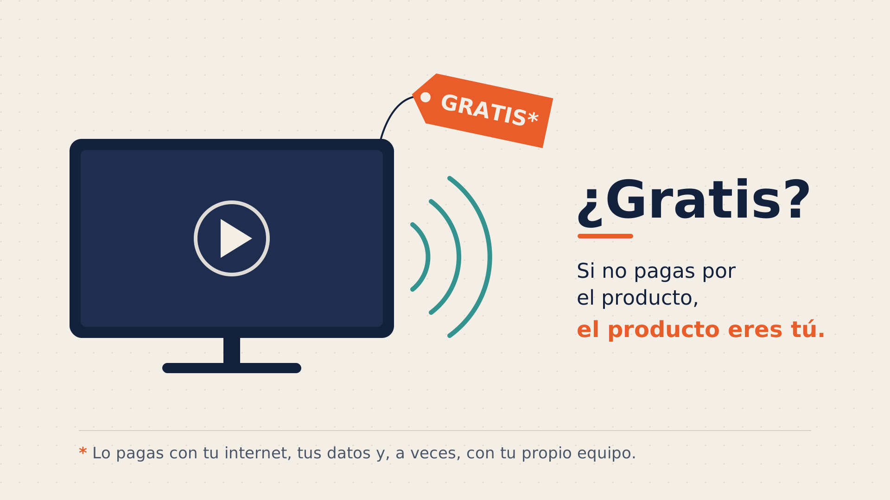
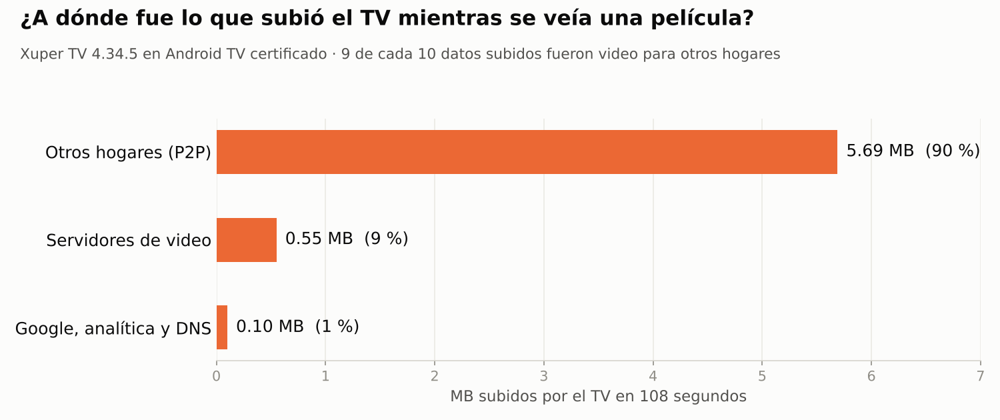

# Ciberseguridad: por qué las apps de IPTV pirata son "gratis"



> Investigación sobre las apps de películas, series y canales "gratis" para Android TV
> y TV Box (la familia de Magis TV, Xuper TV, Xuper Plus, Hydra y similares): qué hacen
> con tu internet, con tus datos y qué papel juega el aparato donde se instalan.

## En pocas palabras

**1. En la app no se encontró malware.**
Se revisó su código por dentro y se midió su tráfico en un televisor certificado. No
tiene código para atacar, robar contraseñas ni convertir el televisor en parte de una
red de delincuentes. Al cerrarla, deja de enviar datos.

**2. Es gratis porque trabaja con tu internet.**
Mientras ves algo, tu televisor **le envía video a otras casas** (P2P): **9 de cada 10
datos que subió el TV eran video para otras personas**. Así la app se ahorra buena
parte del costo de transmitir, y lo pagas tú con tu plan. Además:
- el video viaja **sin cifrar**, con un código de tu equipo y de tu usuario a la vista;
- envía **datos a servicios de analítica** de terceros;
- **cambia de dirección** constantemente para que no la bloqueen y **se actualiza sola**
  por fuera de la tienda.

**3. El riesgo grande puede estar en el aparato.**
Los TV Box y sticks **genéricos o clonados** pueden llegar comprometidos **antes de que
los compres**: con el software de fábrica alterado, o modificados por alguien en el
camino que además les instala la app. Un caso real: un stick clonado, con **la misma
app y la misma versión**, estaba atacando a otras redes y cambiaba su identidad para no
ser bloqueado. En un televisor certificado, esa misma app no hacía nada de eso.

### ¿Qué es una botnet?
Una red de aparatos "zombis". Alguien controla a escondidas miles de televisores,
cámaras o TV Box en casas de todo el mundo. Los dueños los siguen usando normal, pero
cuando llega la orden, todos obedecen a la vez usando el internet de cada casa:
- **para atacar**: inundan a una empresa o un banco hasta tumbarlo;
- **para esconderse**: navegan desde tu conexión, y si cometen un fraude queda
  registrada **tu** IP;
- **para estafar**: clics falsos en publicidad, cuentas falsas, robo de contraseñas.

Para el dueño significa internet lento, bloqueos y captchas en páginas web, y en el
peor caso, quedar asociado a delitos que no cometió. No es raro: en 2025 el FBI alertó
sobre [BADBOX 2.0](https://www.bleepingcomputer.com/news/security/fbi-badbox-20-android-malware-infects-millions-of-consumer-devices/),
más de un millón de aparatos así, y en 2024 se descubrió
[Vo1d](https://www.bleepingcomputer.com/news/security/new-vo1d-malware-infects-13-million-android-tv-streaming-boxes/),
en 1,3 millones de TV Box. Ambas campañas afectan a equipos **no certificados**.

### ¿Qué puedo hacer?
1. Usa equipos **certificados** (Android TV / Google TV con Play Protect) y apps de la tienda oficial.
2. Desconfía de los aparatos que se venden "desbloqueados" o "con todo gratis".
3. Si tienes un TV Box genérico, **desconéctalo cuando no lo uses**.
4. Desactiva **UPnP** en tu router, o pídele a tu proveedor que lo haga.
5. Si una app te pide crear una **VPN** y no sabes para qué, responde que **no**.

---

## Evidencias



**Capturas de tráfico** en un televisor Android TV certificado con Xuper TV v4.34.5.
En la línea solo estaba conectado el TV.

| Estado del TV | Duración | Subida | Bajada | Qué se vio |
|---|---|---|---|---|
| En reposo | 21 s | ~0 | ~0 | Nada iniciado por el TV |
| Prendido, sin abrir la app | 2,5 min | 0,02 MB | 0,01 MB | Tráfico normal de Android (Google, hora) |
| **App reproduciendo** | 108 s | **6,3 MB** | 42 MB | Video sin cifrar, **P2P con 24 hogares**, telemetría, dominios aleatorios |
| App cerrada | 6,5 min | 0,05 MB | 0,05 MB | **Sin P2P ni telemetría** |

- [`evidencia-pares-p2p.csv`](evidencia-pares-p2p.csv): los 24 pares P2P,
  anonimizados, con lo que el TV les subió y lo que recibió de cada uno. Con algunos,
  el TV subió mucho más de lo que recibió (en un caso, casi 30 veces más).
- El video llegaba por **HTTP plano**, con el identificador del equipo (`dev_id`) y
  del usuario (`user_id`) en la URL y un archivo `_meta.torrent`.
- Telemetría hacia dominios de **Umeng** (analítica de Alibaba).
- **No hubo** tráfico de ataque, puertos de control de botnet ni VPN.
- El router tenía **UPnP desactivado** (tabla vacía, `upnpc -l` sin respuesta), así
  que la app no pudo abrir puertos. Aun así, el P2P funcionó con **STUN**.

---

## Detalles técnicos

### Método
- **Código:** APK de la familia (v4.34.8) analizado sin ejecutarlo, en un entorno
  aislado, con jadx, androguard y revisión de librerías nativas (`.so`).
- **Tráfico:** televisor Android TV certificado con la v4.34.5. Captura con el
  **Packet Sniffer de MikroTik** sobre la interfaz PPPoE de la línea y **Torch** en
  vivo. El PC del analista iba por datos móviles para no mezclar tráfico.
- **Resumen de capturas:** [`resumen_pcap.py`](resumen_pcap.py)
  (`pip install dpkt` → `python3 resumen_pcap.py --cliente <IP> captura.pcap`).

### Análisis del código (APK v4.34.8)

| | |
|---|---|
| SHA-256 | `6c0530661acaede3aaff2600aa6a4a95e7bead1ec46785ee84e15545b2edda7b` |
| Paquete | `com.android.mgstxNF`: imita el nombre de una app del sistema |
| Base | Código de la familia Magis TV, modificado por terceros (sin cobros) |
| Android mínimo | 4.4 (2013): pensada también para TV Box viejos |

**Lo que trae:**
- **Motor P2P** con UPnP (abrir puertos), STUN (atravesar NAT) e intercambio de pares.
- **SDK de Umeng/Alibaba**: intenta leer el nombre y el BSSID del Wi‑Fi, las redes cercanas y el operador.
- **ID del equipo derivado del DRM (Widevine)**: no cambia aunque se restablezca de fábrica.
- **VPN WireGuard propia** (solo en la variante modificada): puede enrutar todo el tráfico del equipo (`0.0.0.0/0`). Pide confirmación al usuario. En la v4.34.5 no existe esta opción.
- **Evasión de bloqueos**: DNS sobre HTTPS y desvío de consultas DNS.
- **Actualización por fuera de la tienda** (`REQUEST_INSTALL_PACKAGES`).
- **Protecciones anti‑análisis**: textos cifrados, detección de depuración y verificación de firma.

**Lo que no trae:** código de ataque, envío masivo de UDP, comunicación con servidores
de control de botnet, SDK de proxy residencial, cambio de MAC (solo la lee) ni arranque
automático.

**Permisos que sobran en una app de video:** `REQUEST_INSTALL_PACKAGES`, `GET_TASKS`,
`MOUNT_UNMOUNT_FILESYSTEMS` y servicios VPN.

### El caso del stick clonado
Un stick con marca falsificada y Xuper TV 4.34.5 generaba un **ataque UDP de 34 Mbps**
contra un /24 completo (carpet bombing) y abría ráfagas de conexiones al **TCP 9377**.
Además, **cambiaba de MAC en cada conexión**: 112 MAC con el mismo prefijo no
registrado. Una app sin privilegios no puede cambiar la MAC, y la misma app y versión en
un TV certificado no generó nada parecido. El comportamiento venía del **sistema del
aparato**, ya sea de fábrica o de quien lo modificó antes de venderlo.

### Indicadores para detectar

| Señal | Indica |
|---|---|
| UDP de subida a muchas IP residenciales mientras se ve TV | P2P de la app |
| HTTP plano con `dev_id` / `user_id` / `.torrent` en la URL | Video de la app |
| Subida ≈ bajada sostenida | Proxy residencial (botnet) |
| UDP a muchas IP del mismo /24 desde un solo puerto | Ataque DDoS (carpet bombing) |
| TCP persistente a puertos 100–299, 9377 o 9100 | Canal de control de botnet |
| Muchas MAC con el mismo prefijo no registrado | Aparato que cambia de identidad |
| ADB anunciado por mDNS (`_adb._tcp.local`) | TV Box expuesto |

**Filtros de Wireshark:**
```
stun || http.request.uri contains "dev_id" || http.request.uri contains ".torrent"
tcp.port in {9377 9100} || (tcp.port >= 100 && tcp.port <= 299)
ssdp || (mdns && dns.qry.name contains "_adb")
```

**Recomendaciones para proveedores de internet:**
- **UPnP desactivado por defecto** en las ONU.
- Detectar por **comportamiento** (puertos y patrones), porque las IP de los servidores cambian.
- Antes de bloquear por MAC, revisar la lista de equipos de la ONU.
- Aislar equipo por equipo y volver a medir a las 24 y 48 horas.

### Alcance y limitaciones
- El código analizado es de la v4.34.8 y el tráfico de la v4.34.5. Las capturas son
  de minutos, no de días. La app puede cambiar con una actualización.
- **No se incluyen:** la app ni enlaces de descarga; datos de clientes, de la empresa
  ni IP de usuarios (los pares P2P están anonimizados); los servidores de los
  operadores de la app ni cómo saltarse sus protecciones; capturas `.pcap` crudas,
  porque contienen identificadores del equipo de prueba.

---

**Autor:** Anderson Mateo Iglesias Suarez · Ingeniería de Sistemas · Redes y ciberseguridad
